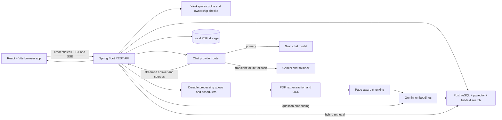
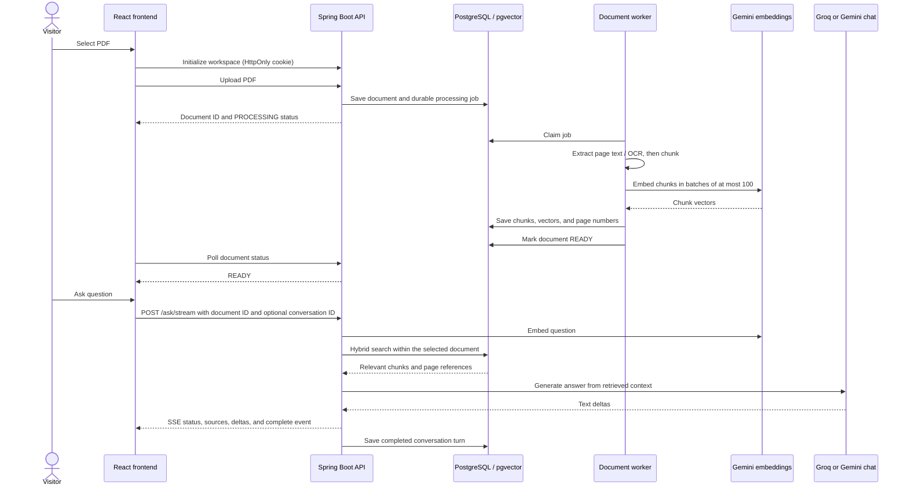

# DocMind AI

DocMind is a document-grounded question-answering app. Upload a PDF, wait for it to be indexed, then ask questions and receive answers with page citations. The backend streams generated text to the React chat UI and keeps conversations in the current browser workspace.

## What it does

- Accepts PDF uploads up to 20 MB and processes them asynchronously.
- Extracts text page by page, using Tesseract OCR for pages where ordinary PDF text extraction is insufficient.
- Splits extracted text into overlapping chunks, creates Gemini embeddings, and stores vectors and full-text indexes in PostgreSQL with pgvector.
- Retrieves relevant passages with hybrid vector and keyword search, then asks a chat model to answer from those passages only.
- Streams answer deltas to the browser and shows each cited source page once.
- Saves conversation history and lets the browser restore previous conversations.
- Uses an anonymous, HttpOnly workspace cookie instead of a login. Private documents and conversation history are scoped to that browser workspace.
- Supports public documents for showcase use. Public documents can be read from any workspace, while their chat histories remain workspace-private.
- Provides “Try the demo” and “Ask about Prasad” showcase selectors with document-specific descriptions and rotating, clickable sample questions.
- Lets visitors switch between showcase documents from the chat composer; selecting a private PDF clears the showcase selection, and clicking an active selector clears the document selection.
- Resumes the most recently updated conversation when a visitor selects a document; “New chat” starts a fresh conversation.
- Retries durable document-processing jobs after application restarts and queues cleanup when stored files cannot be deleted immediately.
- Removes documents older than five days by default, unless `retention_exempt` is enabled for a document.
- Includes a compact developer profile in the frontend header.
- Applies persistent per-workspace rate limits to uploads and questions, returning `429` with a retry time when a limit is reached.

> The showcase PDFs are user-provided data and are not included in this repository. Configure their document IDs for each database using the frontend environment variables described below.

## Architecture



### Upload and question flow



## Technology

| Area | Technology |
| --- | --- |
| Backend | Java 21, Spring Boot 4, Spring AI 2 |
| Chat models | Groq OpenAI-compatible API and Gemini, with transient-error fallback |
| Embeddings | Gemini `gemini-embedding-2`, 768 dimensions |
| Database | PostgreSQL 17 with pgvector and Flyway migrations |
| PDF processing | Apache PDFBox and optional Tesseract OCR |
| Frontend | React 19 and Vite |

The backend uses Gemini for embeddings regardless of which chat provider is primary. Both provider keys are currently required because the chat router wires both providers for fallback.

## Repository layout

```text
.
├── frontend/                 React + Vite app
├── src/main/java/            Spring Boot controllers, services, jobs, and persistence
├── src/main/resources/
│   ├── db/migration/          Flyway schema migrations
│   └── application.yml       Backend configuration and local defaults
├── API.md                    HTTP API and SSE event reference
├── docker-compose.yml        Local PostgreSQL + pgvector service
└── pom.xml                   Maven build
```

## Requirements

- Java 21
- Docker with Docker Compose, or PostgreSQL 17 with pgvector available
- Node.js and npm (Node.js 20 or newer recommended)
- A Groq API key
- A Gemini API key with access to chat and embedding models
- Tesseract OCR and the English language data for scanned PDFs (optional for PDFs with selectable text)

On Ubuntu, Tesseract can be installed with:

```bash
sudo apt-get update
sudo apt-get install tesseract-ocr tesseract-ocr-eng
```

## Run locally

### 1. Start PostgreSQL

From the repository root:

```bash
docker compose up -d postgres
```

The compose service creates database `docmind_ai` with local development credentials `postgres` / `postgres` and persists its data in the `postgres_data` volume. Flyway applies the migrations when the backend starts. Stopping the service with `docker compose down` keeps the volume; `docker compose down -v` deletes the database data.

### 2. Configure the backend

Export both API keys in the shell that will run Spring Boot:

```bash
export GROQ_API_KEY="your-groq-api-key"
export GEMINI_API_KEY="your-gemini-api-key"
```

Optional settings and their defaults:

| Variable | Default | Purpose |
| --- | --- | --- |
| `CHAT_PRIMARY_PROVIDER` | `groq` | Primary chat provider: `groq` or `gemini`; the other is the fallback for transient errors. |
| `GEMINI_CHAT_MODEL` | `gemini-3.6-flash` | Gemini chat model used by the fallback provider. |
| `FRONTEND_URL` | `http://localhost:5173` | Exact frontend origin allowed by credentialed CORS. |
| `WORKSPACE_COOKIE_SECURE` | `false` | Set to `true` when serving the app over HTTPS. |
| `WORKSPACE_COOKIE_SAME_SITE` | `Lax` | Cookie SameSite setting. Cross-site deployments generally require `None` and `Secure=true`. |
| `APP_STORAGE_PATH` | `/home/prasad/docmindDocuments` | Directory for uploaded PDFs. Choose a writable persistent directory for your machine or deployment. |
| `SPRING_DATASOURCE_URL` | `jdbc:postgresql://localhost:5432/docmind_ai` | PostgreSQL JDBC URL. |
| `SPRING_DATASOURCE_USERNAME` | `postgres` | PostgreSQL user. |
| `SPRING_DATASOURCE_PASSWORD` | `postgres` | PostgreSQL password. Change the local defaults outside development. |
| `VITE_API_BASE_URL` | `http://localhost:8080` | Frontend API base URL; set in `frontend/.env` if the API is elsewhere. |
| `VITE_DEMO_DOCUMENT_ID` | `40` | Public document ID for the Everyday Life Guide demo. |
| `VITE_PROFILE_DOCUMENT_ID` | `46` | Public document ID for Prasad’s profile and portfolio. |
| `RATE_LIMIT_UPLOADS_MAX` | `5` | Maximum PDF uploads allowed per workspace in the configured upload window. |
| `RATE_LIMIT_UPLOADS_WINDOW_SECONDS` | `3600` | Upload rate-limit window length in seconds. |
| `RATE_LIMIT_QUESTIONS_MAX` | `30` | Maximum normal and streamed question requests allowed per workspace in the configured question window. |
| `RATE_LIMIT_QUESTIONS_WINDOW_SECONDS` | `3600` | Question rate-limit window length in seconds. |

Choose a writable storage directory, for example:

```bash
mkdir -p "$HOME/docmindDocuments"
export APP_STORAGE_PATH="$HOME/docmindDocuments"
```

Start the backend from the repository root:

```bash
./mvnw spring-boot:run
```

Spring Boot starts on `http://localhost:8080`. Database migrations run automatically. Keep the API keys out of source control; `.env` files are ignored by Git.

### 3. Start the frontend

In another terminal:

```bash
cd frontend
npm ci
npm run dev
```

Open [http://localhost:5173](http://localhost:5173). On startup, the app initializes the anonymous workspace and stores the workspace token in an HttpOnly cookie. Browser API calls include credentials automatically.

Copy `frontend/.env.example` to `frontend/.env` and adjust the values for your database and backend. For example:

```dotenv
VITE_API_BASE_URL=http://localhost:8080
VITE_DEMO_DOCUMENT_ID=40
VITE_PROFILE_DOCUMENT_ID=46
```

The showcase document IDs are database-specific. Set them to the IDs of the public, retention-exempt demo and profile PDFs in the target environment, then rebuild the frontend. The backend CORS origin must match the frontend origin exactly. For local development, the default is `http://localhost:5173`.

## How to use

1. Open the frontend and upload a PDF (maximum 20 MB), or select one of the public showcase documents on the welcome screen.
2. Uploaded documents show a processing status. The UI checks status every few seconds; after two minutes it shows a delayed notice but continues polling.
3. When status becomes `READY`, ask a question. Showcase documents also provide rotating sample questions that can be clicked to ask immediately.
4. Review the cited page numbers and continue the conversation. Selecting a document resumes its most recently updated conversation in this workspace. Use **New chat** to start a separate conversation.
5. Delete a private document from the library when it is no longer needed. Its chunks and conversations are removed and its stored file is queued for cleanup.

## HTTP API

All endpoints except the workspace initialization require a workspace cookie. The frontend initializes it automatically. See [API.md](API.md) for request and response details, ownership behavior, and the full SSE event contract.

| Method | Endpoint | Description |
| --- | --- | --- |
| `POST` | `/api/v1/workspace` | Initialize or renew the anonymous browser workspace cookie. |
| `POST` | `/api/v1/documents` | Upload a PDF as multipart form field `file`; returns a document ID and status. |
| `GET` | `/api/v1/documents` | List documents visible to the current workspace, including public documents. |
| `GET` | `/api/v1/documents/{id}` | Read the document processing status. |
| `DELETE` | `/api/v1/documents/{id}` | Delete an owned document and its related data. |
| `GET` | `/api/v1/documents/{id}/conversations` | List conversations for this workspace and document. |
| `GET` | `/api/v1/documents/{id}/conversations/{conversationId}/messages` | Restore a conversation’s messages. |
| `POST` | `/api/v1/questions/documents/{id}/ask` | Ask a question and wait for the complete JSON answer. |
| `POST` | `/api/v1/questions/documents/{id}/ask/stream` | Ask a question and receive Server-Sent Events. |

Uploads and question requests are rate-limited per workspace. When a limit is reached, the API returns `429 Too Many Requests` with a `Retry-After` header. Defaults and environment-variable overrides are documented above.

Example non-streaming request:

```bash
curl -c /tmp/docmind-cookies -X POST "http://localhost:8080/api/v1/workspace"

curl -b /tmp/docmind-cookies -X POST "http://localhost:8080/api/v1/questions/documents/1/ask" \
  -H 'Content-Type: application/json' \
  -d '{"question":"Summarize this document","conversationId":null}'
```

Replace `1` with the ID returned by upload. For streaming, use `curl -N` with the same cookie jar or the frontend implementation. The browser `EventSource` API does not support this endpoint because it is a `POST` with a JSON body; the frontend uses `fetch()` and reads the response stream.

## Document processing and retention

Document status moves through `PROCESSING`, then `READY` or `FAILED`. Upload creates a durable database job so pending work can be recovered after a restart. Processing is retried up to five times with backoff. Gemini embedding calls are split into batches of no more than 100 chunks.

Documents are retained for five days by default and the retention job checks once every 24 hours. Set `retention_exempt = true` for documents that should stay permanently. Public showcase documents also need `is_public = true`. The current local database uses document ID `40` for the Everyday Life Guide and ID `46` for Prasad’s profile:

```sql
UPDATE documents
SET is_public = TRUE,
    retention_exempt = TRUE
WHERE id IN (40, 46);
```

Use the corresponding IDs from the target database when deploying, and set `VITE_DEMO_DOCUMENT_ID` and `VITE_PROFILE_DOCUMENT_ID` to those IDs before building the frontend.

Public documents can be queried by all workspaces, but visitors cannot delete them unless they own the uploading workspace. Conversations on public documents remain private to the workspace that created them.

## Chat provider behavior

`CHAT_PRIMARY_PROVIDER` selects `groq` or `gemini`. The other provider is used if the primary encounters a recognized transient failure (for example a timeout, rate limit, or server error). Streaming fallback happens only before any answer text has been emitted, so a single answer is not mixed across two providers. Gemini remains the embedding provider.

## Development commands

Backend compile:

```bash
./mvnw -DskipTests compile
```

Run backend tests:

```bash
./mvnw test
```

Frontend production build:

```bash
cd frontend
npm run build
```

## Deployment notes

- Keep Groq and Gemini keys in the deployment platform’s secret manager, never in frontend code.
- Set `FRONTEND_URL` to the deployed frontend’s exact origin.
- Serve the frontend and API over HTTPS; set `WORKSPACE_COOKIE_SECURE=true`.
- Use `WORKSPACE_COOKIE_SAME_SITE=None` only if the browser treats the frontend and API as cross-site; `None` requires `Secure=true`.
- Use managed PostgreSQL with pgvector enabled and persistent storage for uploaded PDFs.
- Change the local database credentials and storage path defaults for deployment.
- Provide a backup/retention plan for PostgreSQL and the PDF storage directory.

## Current showcase status

The Everyday Life Guide demo PDF (document ID `40`) and Prasad profile PDF (document ID `46`) are indexed in the current local database and marked public and retention-exempt. Their presentation titles, descriptions, and sample questions are configured in the frontend. The PDFs themselves are not committed to this repository. Document IDs can differ between environments; configure the two Vite variables before each production build.
